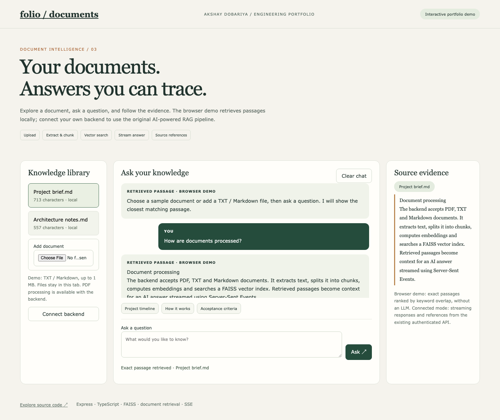
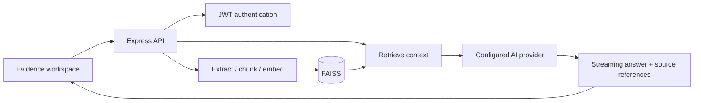

# Document Analysis — RAG API & Evidence Workspace

A TypeScript/Express document intelligence backend with a new portfolio interface for document selection, uploads, chat and source evidence. The repository contains **both backend and frontend**; the frontend is in `public/portfolio`.

## Try the browser demo

```sh
node scripts/serve-portfolio.mjs
```

Open `http://127.0.0.1:4175`. No install, account or AI key is required. Select a sample or add a TXT/Markdown file (up to 1 MB), ask a question and inspect an exact source passage. Files remain in this tab. This mode uses **local keyword retrieval, not AI generation**. PDF parsing requires the connected backend.



## Existing backend capabilities

- PDF, TXT and Markdown ingestion, chunking and embeddings.
- FAISS vector search and retrieval-augmented chat.
- Agent/prompt management, file-backed application records and JWT authentication.
- Streaming answers over Server-Sent Events and Socket.IO.



## Run the connected backend

Use Node.js 20+, pnpm and a host that supports native `faiss-node` bindings. FAISS and the embedding pipeline have native/model dependencies; a static-only host cannot run this backend.

```sh
pnpm install
cp .env.example .env
# Set a strong JWT_SECRET and the model provider keys used by the services.
pnpm dev
```

The example port is 3000. API health: `/api/v1/health`. With the backend running, open `/portfolio/index.html` on the same origin, or use **Connect backend** in the standalone demo. Enter the backend origin and an account you registered through `POST /api/v1/auth/register`:

```json
{"email":"you@example.com","password":"your-own-strong-password","firstName":"Your","lastName":"Name"}
```

The UI signs in through `/api/v1/auth/login`, uploads to `/api/v1/prompts/create`, creates a chat session and consumes the existing message SSE stream. Uploads support PDF/TXT/Markdown up to 10 MB per file. Connected mode sends documents to your backend. Tokens are kept only in tab memory; remote backend connections require HTTPS.

## Public copy hygiene and verification limits

Runtime user records, sessions, stored prompts, uploads and vector indexes were removed from the **copied Git history** before publication. Original source repositories and local archives were not modified. Generated data is ignored going forward. Commit hashes differ from the original because of this cleanup.

The portfolio UI is tested with a mocked API contract. A live end-to-end model response still requires native dependencies, valid service credentials and an operational backend. The existing RAG and authentication code is a proof of concept and has not been audited for public multi-user production use.
